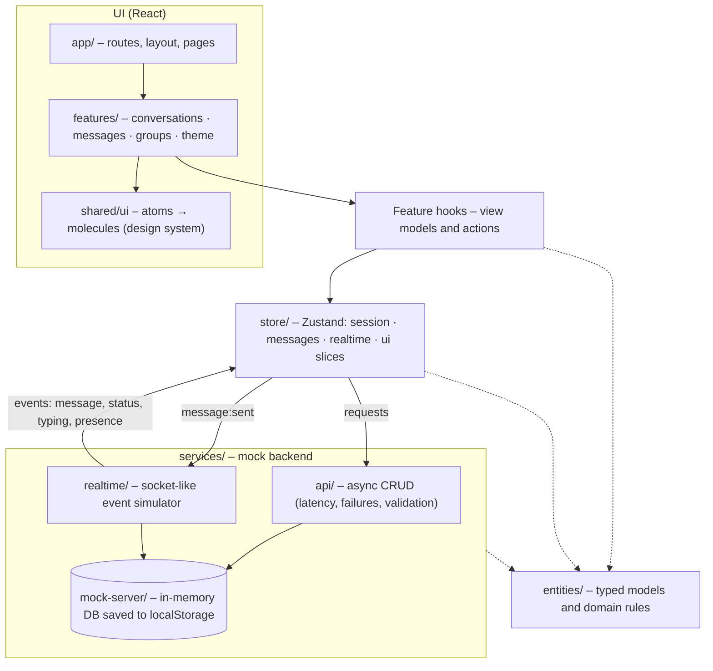

# Chat App

A responsive chat app, similar to a simplified Slack or WhatsApp Web, with direct and group
conversations. It is built with **React 19, TypeScript, Vite, Tailwind CSS and Zustand**, and runs on a
mock backend that simulates a real server (latency, failures, realtime events, persistence).


## Contents

- [Features](#features)
- [Getting started](#getting-started)
- [Architecture](#architecture)
- [State management](#state-management)
- [Key decisions](#key-decisions)
- [Design system and accessibility](#design-system-and-accessibility)
- [Performance](#performance)
- [Testing and quality](#testing-and-quality)
- [Assumptions, shortcuts and trade-offs](#assumptions-shortcuts-and-trade-offs)

## Features

**Chat sidebar.** Conversations sorted by latest activity, with profile pictures and an online dot,
the last message with time and delivery ticks, unread badges, and "typing…" previews.
Debounced search (Ctrl/⌘+K) and All / Unread / Groups filters, each with its own empty state.

**Chat window.** A virtualized message list (the "Engineering" chat has 10,000 messages) with
date separators, grouped consecutive messages, an "unread messages" divider and smart auto-scroll.
Smart auto-scroll follows new messages only when you are at the bottom; otherwise a
"↓ 3 new messages" button appears. Older pages load as you scroll up without the view jumping.
The window also shows typing indicators and sending → sent → delivered → read receipts.

**Message actions.** Reply (with a quoted preview), edit (also ↑ in an empty composer), copy, delete
(with confirmation) and emoji reactions. Actions appear on hover, keyboard focus or long-press.

**Composer.** Built with React Hook Form. Enter sends, Shift+Enter adds a new line, and drafts are
saved per chat. It enforces a 4000-character limit with a counter and supports attachments
(image and file previews). Sending is optimistic, with retry for failed messages.

**Groups.** A group info panel with description, members, online status and admin badges.
Members can be added (validated form) or removed.

**User experience.**

- Layout: responsive for phone, tablet and desktop.
- Themes: dark and light, following the system first and remembering your choice.
- States: loading, empty and error states, including an offline banner and a queue that sends
  messages when you reconnect.
- Search: message search within a chat, which can jump to old messages.
- Unread: unread count in the tab title.

## Getting started

Requirements: **Node.js 22+** (`.nvmrc` pins 24) and npm.

```bash
git clone https://github.com/hardik6869/chat-app.git
cd chat-app
npm ci
npm run dev        # http://localhost:5173
```

| Script                 | What it does                                       |
| ---------------------- | -------------------------------------------------- |
| `npm run dev`          | Start the dev server                               |
| `npm run build`        | Type-check and build for production (`dist/`)      |
| `npm run preview`      | Serve the production build locally                 |
| `npm test`             | Run all tests once (`npm run test:watch` to watch) |
| `npm run coverage`     | Tests with coverage (fails under 80%)              |
| `npm run lint`         | ESLint with zero warnings allowed                  |
| `npm run typecheck`    | TypeScript in strict mode                          |
| `npm run format:check` | Prettier check (`npm run format` to fix)           |
| `npm run knip`         | Finds unused files, exports and dependencies       |

**Mock backend settings** (optional): copy `.env.example` to `.env.local`.

| Variable                 | Default | Meaning                                           |
| ------------------------ | ------- | ------------------------------------------------- |
| `VITE_MOCK_LATENCY_MS`   | `400`   | Average delay of each mock request                |
| `VITE_MOCK_FAILURE_RATE` | `0`     | Chance (0–1) a request fails, to see error states |

**Try it:**

- **Offline mode:** use DevTools → Network → Offline.
- **Fresh mock data:** run `localStorage.clear()` in the console and reload.

## Architecture

Code is organized **by feature**, and each layer only depends on the layers below it. Every folder
exposes a barrel (`index.ts`), and modules are imported through `@/…` aliases.



```text
src/
  app/            Router, layout (AppShell, offline banner), pages, session hooks
  design-system/  Colour tokens (light/dark), Tailwind theme, global a11y styles
  entities/       User, Conversation, Message types and domain rules (+ MessageStatusIcon)
  features/
    conversations/  Sidebar, list, search and filters
    messages/       Chat window, virtualized list, bubbles, composer, actions, search
    groups/         Group info panel, members, add-member form (lazy-loaded)
    theme/          Theme store and toggle
  services/       Mock API, realtime simulator, persistence, seed data
  shared/         Reusable UI (atoms, molecules), hooks and helpers
  store/          Zustand store, slices, selectors
  test/           Test setup and helpers (axe, test store, layout mocks)
```

**Rules that keep it clean**

- **Components** receive props and emit events. Logic lives in hooks, data in the store and I/O in
  services. Components never import `services`.
- **Features** never import each other. The app layer composes them through slots, for example
  `<ChatWindow headerActions aside>` with the group panel.
- **The mock backend sits behind one composition root** (`services/index.ts`), so swapping in a
  real HTTP API or WebSocket only changes that file.
- **Every effect, subscription and timer returns a cleanup.**

## State management

**One Zustand store** split into four slices (`store/slices`):

| Slice      | Owns                                                                     |
| ---------- | ------------------------------------------------------------------------ |
| `session`  | Current user, users, conversations, active chat, unread markers, members |
| `messages` | Messages by id, per-chat threads (ids, paging, status), offline outbox   |
| `realtime` | Applying server events; who is typing                                    |
| `ui`       | Drafts (saved), reply/edit target, pending delete, focused message       |

**Why Zustand.** It is small, needs little boilerplate, works with hooks and selectors, and supports
persistence through middleware. Redux Toolkit would also fit, but needs more setup code for the same
result here.

**How it is kept fast and correct:**

- **Normalized data.** `messages` is keyed by id, and threads hold ordered ids, so updating one
  message doesn't touch the others.
- **Narrow subscriptions.** The list subscribes only to ordered ids, and each row and bubble
  (`memo`) subscribes to its own data with `useShallow`. A new message re-renders one row.
- **Optimistic updates.**
  - Sending shows a message instantly as "sending", which becomes "sent" or "failed (retry)".
  - Edits, deletes and reactions apply immediately and roll back only the changed fields if
    the server rejects them.
- **Realtime safety.** Duplicate messages are ignored, receipts only move forward
  (read never goes back to delivered), and the open chat stays read.
- **Dependency injection.** `createChatStore({ api, realtime })` lets tests use fakes.

## Key decisions

| Decision                               | Why                                                                                                                              |
| -------------------------------------- | -------------------------------------------------------------------------------------------------------------------------------- |
| Mock backend shaped like a real one    | Async calls with latency, random failures, typed `ApiError` codes and cloned responses, so the UI handles real-world conditions  |
| Client-generated message ids           | Makes optimistic sending and retries idempotent (no duplicates)                                                                  |
| Socket-like realtime simulator         | `connect / subscribe / send / disconnect`. It pauses in hidden tabs and goes quiet offline                                       |
| TanStack Virtual for messages          | Handles 10,000+ messages, with measured row heights, anchored "load older" and smart auto-scroll                                 |
| React Router                           | Deep links (`/c/:id`), refresh keeps the open chat, and the phone back button works                                              |
| Native `<dialog>` for modals           | The browser handles focus trapping, inert background, Esc and focus return                                                       |
| Persistence saves only what changed    | A small meta record plus per-chat message entries. Untouched chats are rebuilt from a deterministic seed instead of being stored |
| TypeScript 6 (not 7)                   | typescript-eslint supports up to 6.0                                                                                             |
| ESLint 10 + `eslint-plugin-jsx-a11y-x` | The original a11y plugin doesn't support ESLint 10, and ESLint 9 is end-of-life                                                  |

## Design system and accessibility

**"Indigo & Teal" design tokens.** Colours are CSS variables mapped to Tailwind utilities
(`bg-surface`, `text-text-muted`…), with light and dark values. Components never use raw hex
colours. Shared size and style variants keep every control consistent.

**WCAG 2.2 AA:**

- **Contrast.** Every colour pair the UI uses is checked by a test in both themes: 4.5:1 for
  text and 3:1 for icons and borders.
- **Keyboard.**
  - A skip link, visible focus rings and ↑/↓ navigation in the chat list.
  - Shortcuts: Ctrl/⌘+K focuses search, Ctrl/⌘+F searches messages, Esc closes things and
    returns focus.
  - Focus moves to the visible pane on phones.
- **Screen readers.**
  - Landmarks and labels on every control.
  - Live regions announce new messages, typing, toasts, search results and offline status.
  - Virtualized rows carry `aria-setsize` and `aria-posinset`.
- **Never colour alone.** Unread is shown with bold text plus a badge, online with a dot plus text,
  and receipts have labels.
- **Comfort.** Touch targets are at least 40–44 px, `prefers-reduced-motion` is respected, and
  layouts reflow down to 320 px.
- **Checks.** jsx-a11y lint rules, axe assertions in component tests, and Lighthouse
  Accessibility **100**.

## Performance

- **Lighthouse on the production build** (mobile profile, `/c/c-design`): Performance 91–93,
  Accessibility 100, Best Practices 100, SEO 100.
- **Bundle split:** app code 24 kB gzip, React 98 kB, other libraries 37 kB.
  The group panel and message search are lazy-loaded (≈2 kB each).
- **First paint first.** The mock database is created on first use, so building or restoring
  10,000 messages doesn't delay the first paint. Saves write only what changed.
- **Fewer renders.** Virtualization, memoized rows, narrow selectors, a debounced search and a
  cached date formatter keep rendering cheap.

## Testing and quality

- **338 tests (Vitest + Testing Library).**
  - Unit: helpers, entities, store, mock API, simulator and persistence.
  - Component and integration: real chat flows such as sending, replying, editing, reactions,
    search, groups, offline mode and attachments.
  - Accessibility: axe checks on key screens.
- **Coverage:** about 96% of statements and 89% of branches. CI requires at least 80%.
- **Git hooks (Husky).**
  - pre-commit: lint-staged (ESLint + Prettier)
  - commit-msg: commitlint (Conventional Commits)
  - pre-push: type check + tests
- **GitHub Actions CI** on every push: lint, format, type check, knip, coverage, build and `npm audit`.

## Assumptions, shortcuts and trade-offs

- **No real backend or authentication.** You are signed in as "Jordan Lee". The PDF asks for a mock
  API, so everything runs in the browser.
- **Realtime is simulated** with timers instead of a WebSocket server, behind the same
  interface a real socket client would have.
- **Persistence uses localStorage, not IndexedDB.** It is simple and enough for this data size,
  because only changed chats are written. IndexedDB would be the next step for larger histories.
- **Attachments are not uploaded.** They are shown from local object URLs, which only last for the
  browser session. After a reload, images fall back to file chips.
- **The offline queue lives in memory.** Messages queued while offline are sent on reconnect in the
  same session, but not after a page reload.
- **Search is per conversation** and returns the 50 newest matches. Jumping to an old result loads
  pages until it is found, which can take a few seconds in the 10,000-message chat with simulated
  latency.
- **No end-to-end (Playwright) tests.** The PDF asks for unit tests of key components and
  interactions; integration tests with Testing Library cover the main flows instead.
- **English only.** Dates use the browser's locale through `Intl`, but UI text isn't translated.
